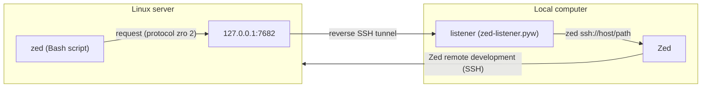

# zed-remote-open

[](https://github.com/franciscocabral/zed-remote-open/actions/workflows/ci.yml)
[](https://github.com/franciscocabral/zed-remote-open/releases/latest)
[](LICENSE)

Open files and directories of a Linux server in the Zed editor of your local
computer, from the terminal of the server. It is like `code .` in VS Code
Remote, for [Zed remote development](https://zed.dev/docs/remote-development).

Current version: <!-- version -->v1.2.1<!-- /version -->

```bash
zed .                         # open the current directory as a project
zed src/app.ts:42:5           # open a file at line 42, column 5
git diff | zed -              # open the text from stdin
git config --global core.editor "zed -w"   # Zed as the editor of git commit
export BROWSER=zed-browse     # gh auth login, ... open the local browser
make && zed --notify "done"   # a notification on the local computer
```

## Contents

- [Quick start](#quick-start)
- [How it works](#how-it-works)
- [Requirements](#requirements)
- [Installation](#installation)
- [Usage](#usage)
- [Settings](#settings)
- [Limitations](#limitations)
- [Versions and updates](#versions-and-updates)
- [Uninstall](#uninstall)
- [Troubleshooting](#troubleshooting)
- [Security](#security)
- [Contributing](#contributing)
- [License](#license)

## Quick start

You need: Zed with the `zed` command, Python 3.10 or later, and SSH key
authentication to the server (`ssh <host>` with no password).

**1. On the local computer** (the computer with Zed):

| System | Commands |
|---|---|
| Windows (Scoop) | `scoop bucket add zed-remote-open https://github.com/franciscocabral/zed-remote-open`<br>`scoop install zed-remote-open`<br>`zed-remote-open-setup` |
| macOS or Linux (Homebrew) | `brew tap franciscocabral/zed-remote-open https://github.com/franciscocabral/zed-remote-open`<br>`brew install zed-remote-open`<br>`zed-remote-open-setup` |

For the installation without a package manager, see
[Installation](#installation). The setup asks for the SSH host of the server,
and then it shows a command for the server.

**2. On the server**, run the command that the setup shows. For example:

```bash
bash <(curl -fsSL https://www.github.com/franciscocabral/zed-remote-open/raw/v1.2.1/remote/remote-linux-installer.sh) -y -h myserver -p 7682 -k <token>
```

**3. Test it** on the server:

```bash
zed --doctor        # all checks must show [ok]
zed .               # Zed opens the current directory
```

## How it works



1. On the server, `zed` sends a request to `127.0.0.1:7682`: the paths, the
   SSH host name and the token.
2. A reverse SSH tunnel takes the request to the same port on the local
   computer. The tunnel is one of these:
   - **managed tunnel** (recommended): the listener keeps its own SSH
     connection with the forward, and reconnects;
   - **`RemoteForward`** in `~/.ssh/config`: the forward belongs to your SSH
     sessions.
3. The listener checks the request and runs `zed ssh://<host>/<path>` for
   each path.
4. Zed opens the path through its own SSH connection to the server.

| Directory | Computer | Files |
|---|---|---|
| [`local/`](local) | The computer with Zed: Windows, macOS or Linux | `zed-listener.pyw`, `local-windows-installer.ps1`, `local-unix-installer.sh` |
| [`remote/`](remote) | Linux server | `zed`, `remote-linux-installer.sh` |
| [`Formula/`](Formula), [`bucket/`](bucket) | Local computer | Homebrew formula, Scoop manifest |

Terms in this document:

- **local**: the computer with Zed.
- **remote** or **server**: the Linux server that Zed opens with remote
  development.
- **host**: only the SSH host name of the server (the `Host` entry in
  `~/.ssh/config`, `zed -h`, and the `hosts` of the listener).

## Requirements

| Computer | Requirements |
|---|---|
| Local | Zed with the `zed` command in `PATH` (on macOS and Linux, run `zed: install cli` in Zed). Python 3.10 or later (on Windows, with `pythonw.exe` from [python.org](https://www.python.org/downloads/windows/)). OpenSSH client. |
| Server | Linux, Bash 4 or later, `curl`, `sha256sum`. |
| Both | Zed connects to the server with remote development (`zed ssh://<host>/`). For the managed tunnel: SSH key authentication from the local computer to the server. |

## Installation

Do the steps in this sequence: first the local computer, then the server.
The package managers of the [Quick start](#quick-start) run the same
installer as the scripts below.

### 1. Local computer

**Windows**, in PowerShell:

```powershell
curl.exe -fsSL -o local-windows-installer.ps1 https://www.github.com/franciscocabral/zed-remote-open/raw/v1.2.1/local/local-windows-installer.ps1
powershell -ExecutionPolicy Bypass -File .\local-windows-installer.ps1
```

**macOS or Linux**, in a terminal:

```bash
bash <(curl -fsSL https://www.github.com/franciscocabral/zed-remote-open/raw/v1.2.1/local/local-unix-installer.sh)
```

The installer:

1. Makes sure that Python is 3.10 or later.
2. Gets the listener, and compares it with `SHA256SUMS` of the same version.
   If the checksum is not correct, it stops.
3. Compares the installed version with the new version (see
   [Versions and updates](#versions-and-updates)).
4. Asks for the port (default `7682`), the SSH hosts that Zed can open (for
   example `myserver`), a token (see [Token](#token)), and the tunnel mode.
5. Installs the listener and `listener.json` in:
   - Windows: `%LOCALAPPDATA%\zed-remote-open`
   - macOS: `~/Library/Application Support/zed-remote-open`
   - Linux: `~/.local/share/zed-remote-open`
6. Starts the listener now and at each login:
   - Windows: the shortcut `zed-listener.lnk` in the Startup folder
   - macOS: the launch agent `~/Library/LaunchAgents/io.github.franciscocabral.zed-remote-open.plist`
   - Linux: `~/.config/autostart/zed-remote-open.desktop`
7. Sets up the SSH tunnel (see [step 2](#2-ssh-tunnel)).
8. Shows the command for the server, with the same port, host and token.

Options:

| Windows | macOS, Linux | Description |
|---|---|---|
| `-Port N` | `-p N` | Listener port (default `7682`). |
| `-Hosts a,b` | `-H a,b` | SSH hosts that Zed can open. |
| `-Token T` | `-k T` | Use this token. |
| `-NoToken` | `-K` | Use no token. |
| `-Tunnel managed` | `-T managed` | Managed SSH tunnel. |
| `-Tunnel config` | `-T config` | `RemoteForward` in `~/.ssh/config`. |
| `-WaitClose` | `-W` | Experimental: `zed -w` also ends when you close the tab (see [Wait mode](#use-zed-as-the-editor-of-the-server)). |
| `-PythonW PATH` | `-P PATH` | The Python to use. |
| `-Yes` or `-y` | `-y` | Ask no questions: use the current or default values, and answer yes. |
| `-Force` | `-f` | Replace a newer version, or install a file of a different version or with a wrong checksum. |
| `-NoAutostart` | `-A` | Do not start the listener at login. |
| `-SkipSshConfig` | `-S` | Do not change `~/.ssh/config`. |
| `-BaseUrl URL` | `ZED_REMOTE_OPEN_URL=URL` | Download from this place (for tests from a branch). |
| `-Uninstall` | `-u` | Uninstall. |

If Windows says that the script "is not digitally signed", use
`-ExecutionPolicy Bypass` as above. The scripts have no signature.

### 2. SSH tunnel

> **Without the tunnel, it does not work.** The installer of step 1 sets it
> up, and it asks which mode to use.

| | Managed tunnel (recommended) | `RemoteForward` in `~/.ssh/config` |
|---|---|---|
| Who has the forward | The listener: one `ssh -N -R` connection to the first host | The first SSH session that starts (a terminal, Zed, another editor) |
| After a disconnect | Reconnects after 2 s, then after longer times (at most 60 s) | Stops until a new session starts |
| Other SSH sessions | No warning | Warning `remote port forwarding failed` |
| Needs | SSH key authentication with no password prompt | Nothing more |
| Log | `tunnel-<host>.log` next to `listener.log` | None |

**Managed tunnel.** The installer checks the key authentication with
`ssh -o BatchMode=yes <host> true`. If it does not work, it offers the
`RemoteForward` mode. It also removes its old block from `~/.ssh/config`.
If one of your own `Host` entries has a `RemoteForward` for the port, the
installer tells you to remove that line: else your other sessions still ask
for the port. After a change to the tunnel mode, close the old SSH sessions
to the server (see [Troubleshooting](#the-port-is-in-use-by-another-ssh-session)).

**`RemoteForward`.** The installer asks first, and then:

1. Runs `ssh -G <host>` for each host. If your own entries already forward
   the port, it adds nothing for that host. If they forward the same server
   port to a different place, it changes nothing and tells you.
2. Makes a backup copy: `config.bak.<date>`.
3. Adds a block to the end of the file. It does not change your own entries:
   SSH uses all the `Host` entries that match a name.

   ```
   # BEGIN zed-remote-open (managed by local-windows-installer.ps1, do not edit)
   Host myserver myserver.ts
       RemoteForward 127.0.0.1:7682 127.0.0.1:7682
   # END zed-remote-open
   ```

4. Keeps the line endings and the file permissions. On Windows, it writes
   UTF-8 without a BOM (OpenSSH does not accept a BOM).
5. Runs `ssh -G <host>` again to verify the result.

The installer replaces the block when you install again, and the uninstall
removes it. To do this step manually, use `-SkipSshConfig` or `-S`, and add
the `RemoteForward` line above to the `Host` entry of each server. Then close
the SSH sessions to the server and connect again.

### 3. Server

In an SSH session to the server, run the command that the local installer
shows (see the [Quick start](#quick-start)). With no options, the installer
asks for each value:

| Option | Value |
|---|---|
| `-h HOST` | The SSH host name that the local computer uses for this server. It must be one of the hosts of the listener. |
| `-p PORT` | The port of the tunnel on the server (default `7682`). |
| `-t TARGET` | The address of the listener (default `127.0.0.1`). |
| `-k TOKEN` | The token of the listener, if it has one. |
| `-y` | Ask no questions. |
| `-f` | Replace a newer version, or a `zed` command of a different program. |
| `-u` | Uninstall. |

The installer downloads `zed`, compares it with `SHA256SUMS` of the same
version, installs it in `~/.local/bin` with the link `zed-browse`, saves the
settings, and runs `zed --doctor`.

If `~/.local/bin` is not in `PATH`, add this line to `~/.zshrc` or `~/.bashrc`:

```bash
export PATH="$HOME/.local/bin:$PATH"
```

### Other ways to install

- **Latest release:** these URLs always give the files of the latest release.
  Each release also has `SHA256SUMS`.

  ```
  https://github.com/franciscocabral/zed-remote-open/releases/latest/download/local-windows-installer.ps1
  https://github.com/franciscocabral/zed-remote-open/releases/latest/download/local-unix-installer.sh
  https://github.com/franciscocabral/zed-remote-open/releases/latest/download/remote-linux-installer.sh
  ```

- **winget** is not available. winget accepts only `.exe`, `.msi` and similar
  installers, not a PowerShell script.

## Usage

```
zed [OPTIONS] [PATH[:LINE[:COLUMN]]...]
command | zed [OPTIONS] -
```

| Option | Description |
|---|---|
| `-w` | Wait until you save the file in Zed (for `EDITOR`). |
| `-p PORT`, `-h HOST`, `-t TARGET` | Port, SSH host name and listener address for this call. |
| `-c KEY:VALUE` | Save a value in the settings file (see [Settings](#settings)). |
| `--browse URL` | Open an `http://` or `https://` URL in the browser of the local computer. `zed-browse URL` is the same. |
| `--notify [MESSAGE]` | Show a notification on the local computer. With no MESSAGE, the text comes from stdin. |
| `--completion bash\|zsh` | Print the shell completion. |
| `--doctor` | Check the settings and the connection to the listener. |
| `--update` | Install the latest release of `zed`. |
| `--uninstall` | Remove `zed`, `zed-browse` and the settings from the server. |
| `--help`, `--version` | Show the help or the version. |

- With no path, `zed` opens the current directory as a project.
- Zed opens each path in a window of its own (see [Limitations](#limitations)).
- `PATH:LINE` and `PATH:LINE:COLUMN` open the file at that position. A file
  that exists with such a name is never split.
- If a path does not exist, `zed` asks before it creates it. A path that ends
  with `/` becomes a directory.
- `-` saves stdin in `~/.cache/zed-remote-open/` and opens that file. The
  files stay for 7 days.

### Use Zed as the editor of the server

```bash
git config --global core.editor "zed -w"   # for Git
export EDITOR="zed -w"                     # for other programs (crontab -e, ...)
```

Git uses the first of these that is set: `GIT_EDITOR`, `core.editor`,
`VISUAL`, `EDITOR`. So `EDITOR` alone has no effect on Git if `core.editor`
is set. `git var GIT_EDITOR` shows the editor that Git uses.

`zed -w` waits until one of these occurs:

| Action | Result |
|---|---|
| Save in Zed (Ctrl+S) | Exit code 0: Git continues. |
| Close the tab in Zed (only with `-WaitClose` / `-W`) | Exit code 0. |
| Enter in the terminal | Exit code 0, with no save. |
| Ctrl+C in the terminal | Exit code 1: Git stops (cancel). |

Why the save is the signal: the Zed CLI cannot wait for a remote file
(`zed --wait` ends at once for `ssh://` URLs), and the server cannot see when
a tab closes.

**Experimental close detection** (`-WaitClose` / `-W`): the listener reads
the database of Zed on the local computer, read-only. It finds the open tabs
in the `items` table, joined with the path in the `editors` table (tested
with Zed 1.27). If a Zed update changes these tables, or the file does not
appear in 20 seconds, `zed -w` tells you and waits for the save.

> If Zed autosave is on (`"autosave": "after_delay"` or `"on_focus_change"`),
> the first autosave ends the wait.

### Open URLs in the local browser

```bash
export BROWSER=zed-browse      # in ~/.zshrc or ~/.bashrc
gh auth login                  # the login page opens on the local computer
zed --browse https://example.com
```

Only `http://` and `https://` URLs (at most 4096 characters) are accepted.
`localhost` in a URL is the local computer, not the server.

### Notifications

```bash
make && zed --notify "build finished" || zed --notify "build failed"
long-task | tail -n 1 | zed --notify          # the text from stdin
```

The title is `zed-remote-open: <host>`, and the message is one line of at
most 1000 characters. The local computer shows it with a Windows
notification, the macOS Notification Center, or `notify-send` on Linux
(install `libnotify-bin` or `libnotify`).

### Shell completion

```bash
eval "$(zed --completion zsh)"     # in ~/.zshrc, after compinit
source <(zed --completion bash)    # in ~/.bashrc
```

## Settings

### Server

File: `~/.config/zed-remote-open/settings.json` (mode `600`).

| Key | Value | Environment variable |
|---|---|---|
| `host` | SSH host name of this server (default: `hostname -s`) | `ZED_SSH_HOST` |
| `port` | 1 to 65535 (default `7682`) | `ZED_LISTENER_PORT` |
| `target` | Address of the listener (default `127.0.0.1`) | `ZED_LISTENER_HOST` |
| `token` | The token of the listener | `ZED_LISTENER_TOKEN` |

Precedence: option > environment variable > settings file > default value.

```bash
zed -c port:7700              # save the port
zed -c target:                # remove the target (use the default)
```

### Local computer

File: `listener.json` in the directory of the listener. The installer writes
it; run the installer again to change it.

| Key | Value |
|---|---|
| `port` | Listener port |
| `hosts` | SSH hosts that Zed can open |
| `token` | The token (optional) |
| `tunnel_hosts` | The host of the managed tunnel (optional) |
| `wait_close` | `true` for the experimental close detection (optional) |
| `zed_command`, `ssh_command` | Full paths of `zed` and `ssh` (the installer finds them) |
| `log`, `zed_db`, `browser_command`, `notify_command` | Other paths: the log, the Zed database, the browser and the notification program (optional; the defaults are correct for most users) |

### Token

With a token, the listener accepts only the requests with the same token. Use
it on a server with more than one user: each user of the server can connect
to the forwarded port on `127.0.0.1`.

- The local installer makes a random token (64 hexadecimal characters).
- The server command of the local installer contains the token (`-k`). Your
  shell can save it in its history on the server.
- To change it: the local installer with `-Token <new>` / `-k <new>`, then
  `zed -c token:<new>` on the server.
- To remove it: the local installer with `-NoToken` / `-K`, then
  `zed -c token:` on the server.

## Limitations

- **One window for each path.** The Zed CLI (tested with Zed 1.27) handles
  each `ssh://` URL as a project of its own. It reuses a window only if the
  window has exactly that path, and `--add` has no effect on `ssh://` URLs.
  So a remote file opens in a window of its own, also when the window of its
  project is open. To work in a project, open it with `zed .` and open its
  files with Ctrl+P in Zed. A native `zed` command for remote terminals is a
  request to Zed ([discussion #32214](https://github.com/zed-industries/zed/discussions/32214)).
- **Wait mode** ends at the save, not at the close of the tab, unless the
  experimental close detection is on.
- **Server:** Linux with Bash 4 or later. macOS servers are not supported.
- **One local computer at a time for each server user.** The tunnel and the
  settings of `zed` use one port. To use a second local computer, give its
  listener a different port, and select it with `zed -p <port>` (or
  `ZED_LISTENER_PORT`) on the server.

## Versions and updates

`zed` and the listener have the same version: `zed --version` shows it, and
the listener writes it to its log. The listener sends its version in each
response, and `zed` tells you when the versions are different.

**To update:**

| What | How |
|---|---|
| Server | `zed --update` (it checks the installer with `SHA256SUMS` of the release) |
| Local, with Scoop or Homebrew | `scoop update zed-remote-open` or `brew upgrade zed-remote-open`, then `zed-remote-open-setup -y` |
| Local, with the script | The installer of the latest release, with `-y` |

Before they install, the installers compare the installed version with the
new version:

| Installed version | Result |
|---|---|
| Not installed, or older | Install the new version. |
| Same | Keep the file; change only the settings. |
| Newer | Stop. `-f` / `-Force` installs the older version. |
| A `zed` that is not from zed-remote-open (server) | Ask before it replaces the file. |

Each installer also has its own version, and it installs only the files of
the same version. The installers keep a copy of a replaced `zed` as
`~/.local/bin/zed.bak.<date>`.

## Uninstall

| What | How |
|---|---|
| Server | `zed --uninstall`, or the server installer with `-u` |
| Local, Scoop | `scoop uninstall zed-remote-open` (it also uninstalls the listener) |
| Local, Homebrew | `zed-remote-open-setup -u`, then `brew uninstall zed-remote-open` |
| Local, script | The local installer with `-Uninstall` (Windows) or `-u` (macOS, Linux) |

The local uninstall stops the listener and the managed tunnel, and removes
the files, the autostart entry and the block in `~/.ssh/config`.

## Troubleshooting

Run `zed --doctor` on the server first. It shows each setting, where its
value comes from, and the result of a test request to the listener.

| `zed` shows | Cause | Fix |
|---|---|---|
| `nothing listens on this port of the server, so no SSH tunnel forwards it` | No tunnel to the server | Start the listener on the local computer. Managed tunnel: read `tunnel-<host>.log`. `RemoteForward`: connect again with SSH. |
| `no response from the listener ... (the SSH tunnel works ...)` | The tunnel works, but the listener does not answer | Run the local installer again; it starts the listener again. Read `listener.log`. |
| `host '...' is not allowed` | The host of the server is not in the hosts of the listener | Run the local installer with the correct hosts, or `zed -c host:<name>`. |
| `invalid token` | The token on the server is not the same as in `listener.json` | `zed -c token:<token>` |
| `unsupported protocol` | Incompatible versions | Install the same version on both computers. |
| `the checksum of ... is not correct` | A damaged or changed download | Download again. Use `-f` only if you know why. |

**Logs on the local computer**, in the directory of the listener:
`listener.log` has each request, each rejected request with the reason, and
the exit code and output of each `zed` call (never the token).
`tunnel-<host>.log` has the errors of the managed tunnel.

### The port is in use by another SSH session

`tunnel-<host>.log` shows `remote port forwarding failed for listen port 7682`:
an older SSH session (a terminal, Zed or another editor) started with a
`RemoteForward` for the port, and it still has it. The tunnel tries again
every 60 seconds, and it gets the port when that session closes.

1. Remove the `RemoteForward` line for the port from your `Host` entries in
   `~/.ssh/config`.
2. Find the old sessions. On Windows:

   ```powershell
   Get-CimInstance Win32_Process -Filter "Name = 'ssh.exe'" | Sort-Object CreationDate | Format-Table ProcessId, CreationDate, CommandLine -Wrap
   ```

   On macOS and Linux: `ps -eo pid,lstart,args | grep '[s]sh '`.
3. Close the sessions that started before step 1, in their programs
   (terminal, Zed, editor). Do not stop the process with
   `zed-remote-open\tunnel-` in its command line: it is the managed tunnel.
4. After at most 60 seconds, `zed --doctor` on the server shows `[ok]`.

### Permission denied in the tunnel log

The managed tunnel needs SSH key authentication. Make sure that
`ssh -o BatchMode=yes <host> true` works with no prompt, or use the
`RemoteForward` mode (`-Tunnel config` / `-T config`).

## Security

- The listener accepts connections only on `127.0.0.1`.
- It accepts only the hosts in its settings and only absolute paths. If one
  line of a request is not valid, it rejects the full request.
- With a token, it accepts only requests with the same token (constant-time
  comparison). The settings files with the token have mode `600`; on Windows,
  they are in `%LOCALAPPDATA%`, which only your user can read.
- A request is limited to 64 KiB, 5 seconds and 100 paths, and the listener
  serves at most 16 connections at the same time.
- It runs `zed` without a shell, and the client cannot add options to the
  `zed` command: the listener makes the command line from the fields of the
  request.
- It opens only `http://` and `https://` URLs. The text of a notification
  goes to the notification program as an argument or an environment
  variable, never as part of a command.
- The installers and `zed --update` compare each download with `SHA256SUMS`
  of the same version. This finds a damaged or changed download. It does not
  protect against a change on GitHub itself, because `SHA256SUMS` comes from
  the same place.

## Contributing

Use [Conventional Commits](https://www.conventionalcommits.org/): the type of
each commit gives the next version. Make a branch and a pull request; CI runs
on each push, except when all the changed files are documentation (`*.md`
and `LICENSE`).

**Tests and lint:**

```bash
python -m unittest discover -s tests -v   # listener and zed (end-to-end tests need Bash 4)
bash tests/test-unix-installer.sh         # both installers in a temporary HOME
shellcheck remote/zed remote/*.sh local/*.sh scripts/*.sh tests/*.sh
ruff check local/zed-listener.pyw tests scripts
```

`tests/test-windows-installer.ps1` changes the Startup folder and
`~/.ssh/config` of the current user: run it only in CI.

**Test the installers from a branch:** run
`scripts/update-packages.py --sums-only`, commit `SHA256SUMS`, push, and use
the URL of the commit: `ZED_REMOTE_OPEN_URL=https://github.com/franciscocabral/zed-remote-open/raw/<commit>`
or `-BaseUrl` (add `-f` / `-Force` if the version is the same).

**CI and releases** ([`.github/workflows/ci.yml`](.github/workflows/ci.yml)).
A push or pull request with only documentation changes (`*.md`, `LICENSE`)
starts no CI run and makes no release.

- **lint:** ShellCheck, Ruff, PSScriptAnalyzer, the syntax of the formula and
  the manifest, and a check that all version lines are the same.
- **test-unix:** Linux (Python 3.10 and 3.13) and macOS.
- **test-windows:** the tests and the installer on Windows PowerShell 5.1.
- **release** (only on `main`, after all tests): it finds the next version
  from the commits since the last tag (`feat` = minor, `fix`/`perf` = patch,
  `!` or `BREAKING CHANGE` = major; other types make no release). It writes
  the version, `SHA256SUMS`, the Homebrew formula and the Scoop manifest, and
  points the download URLs to the new tag. Then it commits
  `chore(release): vX.Y.Z [skip ci]`, makes the tag, and publishes the
  release. The release commit starts no CI run, so there is no loop. Run
  `git pull` after a release.

## License

[MIT](LICENSE) © 2026 Francisco Cabral
